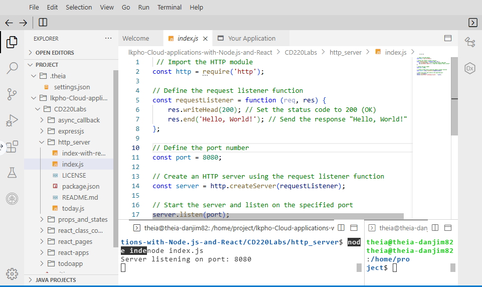
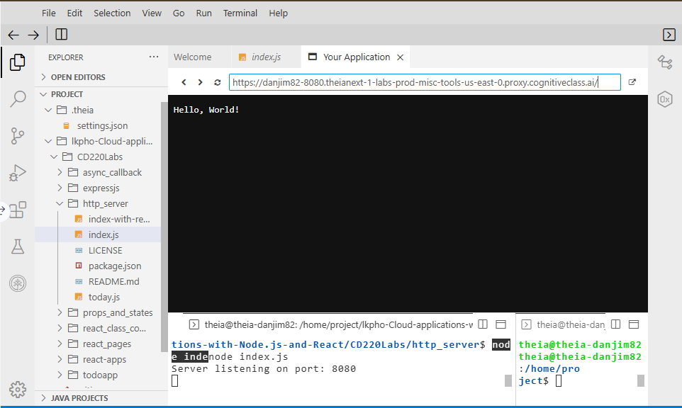
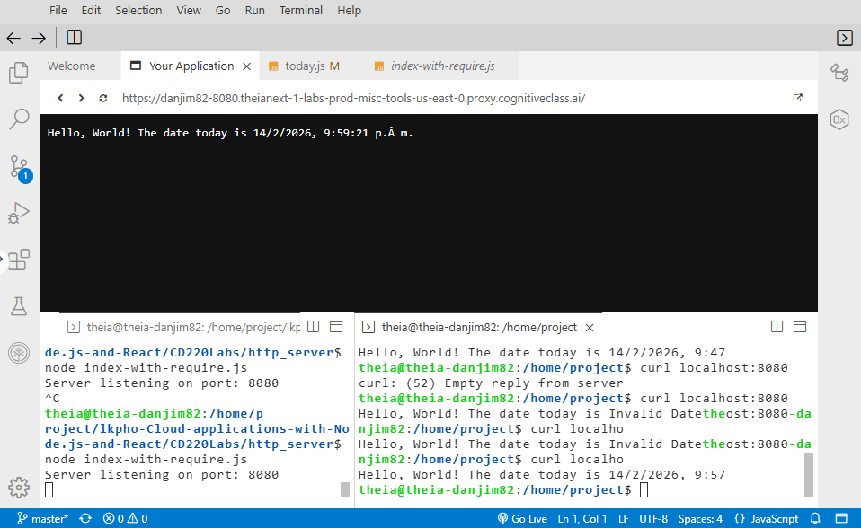

# Laboratorio práctico - Primer servidor con Java Script del lado del servidor

## Paso 1: Verificar el entorno y las herramientas de línea de comandos

Abre una ventana de terminal utilizando el menú en el editor: Terminal > Nueva Terminal.
Verifica que node CLI esté instalado.

```bash
node --version
```

Deberías ver una salida similar a esta, aunque las versiones pueden ser diferentes:

```bash
#v19.9.0
theia@theia-danjim82:/home/project$ node --version
v20.19.5
# Cambia a tu carpeta de proyecto.
cd /home/project
#Clona el repositorio de git que contiene los artefactos necesarios para este laboratorio, si no existe ya.
git clone https://github.com/ibm-developer-skills-network/lkpho-Cloud-applications-with-Node.js-and-React.git
# Cambia al directorio para este laboratorio.
cd lkpho-Cloud-applications-with-Node.js-and-React/CD220Labs/http_server
#Enumera el contenido de este directorio para ver los artefactos de este laboratorio.
ls
#Revisa el contenido de index.js. Este es el script del lado del servidor que ejecutaremos en la siguiente sección.
cat index.js
#Deberías ver una salida similar a esta.
theia@theia-danjim82:/home/project/lkpho-Cloud-applica
tions-with-Node.js-and-React/CD220Labs/http_server$ cat index.js
 // Import the HTTP module
const http = require('http');

// Define the request listener function
const requestListener = function (req, res) {
    res.writeHead(200); // Set the status code to 200 (OK)
    res.end('Hello, World!'); // Send the response "Hello, World!"
};

// Define the port number
const port = 8080;

// Create an HTTP server using the request listener function
const server = http.createServer(requestListener);

// Start the server and listen on the specified port
server.listen(port);
console.log('Server listening on port: ' + port);
```

## Explicación

- `HTTP Module` Importa el módulo HTTP de Node.js.

- `Request Listener Function` Define una función de escucha de solicitudes que maneja las solicitudes HTTP entrantes. En este caso, la función establece el código de estado en 200 (OK) y envía la respuesta “¡Hola, Mundo!”.

- `Port Definition` Define el número de puerto como 8080 usando const port = 8080;

- `Create HTTP Server` Crea un servidor HTTP usando http.createServer(requestListener);, donde requestListener es la función de escucha de solicitudes definida.

- `Server Start` Inicia el servidor y escucha en el puerto especificado usando server.listen(port);. Además, registra un mensaje indicando que el servidor está escuchando en el puerto especificado.

Alternativamente, también puedes ver el contenido de index.js a través del menú del explorador de archivos. Aparecería así.



## Paso 2: Usar el node CLI

Para iniciar el servidor, ejecutamos el archivo index.js con el comando node.

```Bash
node index.js
#Deberías ver una salida similar a esta.
"server listening on port: 8080"
#Para dividir el terminal, haz clic en Dividir Terminal como se muestra en la imagen a continuación.
#En la segunda ventana del terminal, utiliza el comando curl para hacer ping a la aplicación.
curl localhost:8080
#Deberías ver una salida similar a esta.
"Hello, World!"
```

Debería indicar que su aplicación está en funcionamiento.

Para verificar lo mismo con la ventana del navegador, haga clic en el botón Skills Network a la izquierda, se abrirá la “Skills Network Toolbox”. Luego haga clic en Otro y luego en Lanzar Aplicación. Desde allí debería poder ingresar el número de puerto en el que se está ejecutando el servidor, que es 8080 y lanzar.

Se abrirá una nueva ventana del navegador como se muestra a continuación. (Nota: Es posible que no se abra una nueva ventana del navegador si la configuración de su navegador no permite ventanas emergentes)

Para detener el servidor, vaya a la ventana de comandos principal y presione Ctrl+c para detener el servidor y permanecer en esa terminal.



## Paso 3: Usa la CLI node para ejecutar el script del servidor que requiere otro módulo

En la misma terminal, verifica el contenido de today.js.

```bash
cat today.js
#Deberías ver una salida similar a esta.

" // Export a function named 'getDate' from the module
module.exports.getDate = function getDate() {
    // Get the current date and time in the timezone "Australia/Brisbane"
    let aestTime = new Date().toLocaleString("en-US", {timeZone: "Australia/Brisbane"});
    return aestTime; // Return the formatted date and time
};"
```

### Explicación

- `Export Function` Usa module.exports para exportar una función llamada getDate del módulo.

- `Date Formatting` Dentro de la función getDate, obtén la fecha y hora actuales usando new Date().toLocaleString(“en-US”, {timeZone: “Australia/Brisbane”}). Esto formatea la fecha y la hora según la zona horaria “Australia/Brisbane”.

- `Return Value` Devuelve la fecha y hora formateadas usando return aestTime;.

Usaremos este módulo exportado en el script del lado del servidor.

Revisa el contenido de index-with-require.js. Como observarás, este script requiere el módulo `today` cuyo contenido vimos en el paso anterior.

```bash
cat index-with-require.js
# Deberías ver una salida similar a esta.
" // Import the HTTP module
const http = require('http');
// Import the 'today' module
const today = require('./today');
// Define the request listener function
const requestListener = function (req, res) {
    res.writeHead(200); // Set the status code to 200 (OK)
    // Send the response with the current date from the 'today' module
    res.end(`Hello, World! The date today is ${today.getDate()}`);
};
// Define the port number
const port = 8080;
// Create an HTTP server using the request listener function
const server = http.createServer(requestListener);
// Start the server and listen on the specified port
server.listen(port);
console.log('Server listening on port: ' + port);"
```

### Explicación

- `HTTP Module` Importa el módulo HTTP de Node.js.

- `Module Import` Importa el módulo ‘today’ utilizando const today = require(‘./today’);. Esto asume que hay un módulo llamado ‘today’ que exporta una función getDate.

- `Request Listener Function` Define una función de escucha de solicitudes que maneja las solicitudes HTTP entrantes. En este caso, la función establece el código de estado en 200 (OK) y envía la respuesta “¡Hola, Mundo! La fecha de hoy es {fecha actual}” utilizando la función getDate del módulo ‘today’.

- `Port Definition` Define el número de puerto como 8080 utilizando const port = 8080;.

`Create HTTP Server` Crea un servidor HTTP utilizando http.createServer(requestListener);, donde requestListener es la función de escucha de solicitudes definida.

- `Server Start` Inicia el servidor y escucha en el puerto especificado utilizando server.listen(port);. Además, registra un mensaje indicando que el servidor está escuchando en el puerto especificado.

Para iniciar el servidor, ejecutamos el archivo index-with-require.js con el comando node.

```Bash
node index-with-require.js
#Deberías ver una salida similar a esta.
"server listening on port: 8080"
#En la segunda ventana de terminal que abriste anteriormente, usa el comando curl para hacer ping a la aplicación.
curl localhost:8080
#Deberías ver una salida similar a esta.
theia@theia-danjim82:/home/project$  curl localhost:8080
"Hello, World! The date today is 2/15/2026, 11:42:04 AM"
```

Debería indicar que su aplicación está en funcionamiento.

## Desafío:

Realiza cambios en index-with-require.js y today.js para saludar al usuario según la hora del día.

- Actualiza today.js para que devuelva un objeto Date adecuado con la zona horaria correcta aplicada, en lugar de devolver una cadena de toLocaleString().

solucion:
today.js

```Javascript
 // Export a function named 'getDate' from the module
module.exports.getDate = function getDate() {
    // Get the current date and time in the timezone "Australia/Brisbane"
    return new Date().toLocaleString("es-VE", {timeZone:'America/Caracas'});    ;

};
```

```bash
theia@theia-danjim82:/home/project$ curlost:8080
"Hello, World! The date today is 14/2/2026, 9:47:37 p. m."
```

- Modifica index-with-require.js para utilizar el objeto Date actualizado de today.js.
- Estos cambios asegurarán que funciones como getHours() operen correctamente.


