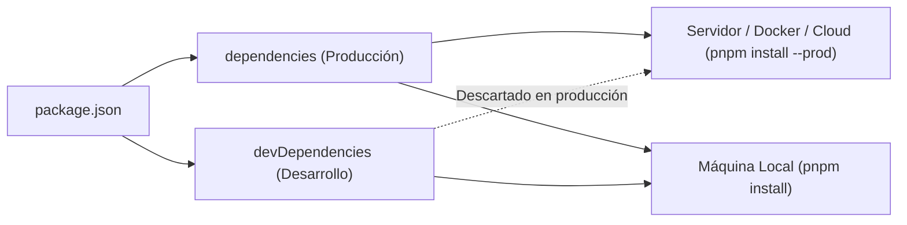

# Carpeta: Utilidades y Herramientas (Tooling & CLI)

Este directorio centraliza la documentación y guías sobre **herramientas de línea de comandos (CLI), scripts de automatización, linters, empaquetadores y utilidades de entorno**.

> [!NOTE]
> **Diferencia con `librerias/`:**
> - En **`librerias/`** documentamos código que se importa y consume dentro de la lógica de la aplicación (`import`/`require`).
> - En **`utilidades/`** documentamos herramientas externas, ejecutables de soporte, vigilantes y utilidades que asisten al ciclo de vida del proyecto.

---

## Gestión de Dependencias: Producción vs Desarrollo

Cuando administramos paquetes con `npm`, `pnpm` o `yarn`, la distinción entre dónde se instala cada herramienta define cómo se comporta en despliegue:

### ¿Qué hace el gestor de paquetes al desplegar?
1. **Entorno Local (`pnpm install`):** Descarga todo para que puedas programar, probar y compilar.
2. **Entorno Productivo (`pnpm install --prod` o `npm ci --omit=dev`):** Omite deliberadamente todas las `devDependencies`. Esto mantiene la imagen de Docker compacta, reduce tiempos de transferencia y elimina vulnerabilidades de desarrollo en el servidor.

---

## Índice Clasificado de Utilidades

### 1. Utilidades de Desarrollo (`devDependencies`)

Herramientas que optimizan el flujo de trabajo del programador, formatean código, compilan o vigilan cambios en local, pero **nunca** tocan el servidor final.

| Herramienta | Tipo | Propósito Principal | Ficha |
| :--- | :--- | :--- | :--- |
| **`nodemon`** | CLI / File Watcher | Reinicio automático del proceso Node al detectar cambios en archivos. | [nodemon.md](file:///c:/Personal%20Daniel/node.js/utilidades/nodemon.md) |

---

### 2. Utilidades de Producción (`dependencies` / Runtime)

Herramientas o utilidades ejecutables que sí deben acompañar al proceso en el servidor productivo (por ejemplo: gestores de procesos en segundo plano, balanceadores o utilidades de monitoreo del sistema).

| Herramienta | Tipo | Propósito Principal | Ficha |
| :--- | :--- | :--- | :--- |
| *(Próximamente)* | - | Ej: `pm2` para mantener procesos vivos en servidores dedicados. | - |

---

### 3. Utilidades Mixtas o Híbridas

Herramientas cuya ubicación varía según si el proyecto compila antes de desplegarse o si se ejecutan directamente en el servidor.

| Herramienta | Tipo | Escenario Típico | Ficha |
| :--- | :--- | :--- | :--- |
| *(Próximamente)* | - | Ej: `typescript`, `ts-node`, transpiladores o bundlers. | - |
